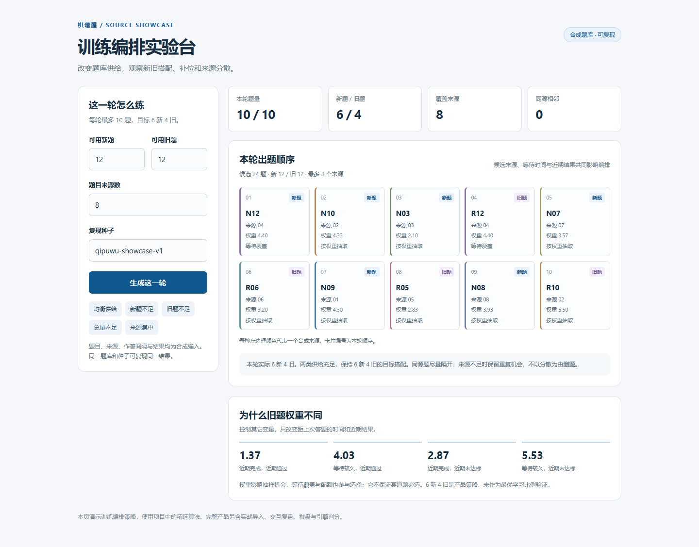

# QipuWu · Xiangqi Review & Practice

**Connecting real games, engine-assisted review and targeted practice.**

[中文](README.md) · [Product design](docs/product-design.md) · [Source provenance](docs/source-provenance.md)

QipuWu is a personal Xiangqi learning system built around a recurring workflow: review a game, explore alternatives, choose positions to revisit, practise, and return to the original context.

This repository contains QipuWu's practice scheduler, design notes and an interactive lab using synthetic practice items.



## Product workflow

Game records → engine analysis → interactive review → personal collection → practice → return to the original game.

The full product supports move-level review, free variations, user-selected practice material, review scheduling and repeated opening positions.

## Practice scheduling

The scheduler uses:

- a target of six new items and four review items per round;
- borrowing between pools when either is short;
- priorities based on elapsed time and recent outcomes;
- a soft preference for varied game sources;
- deterministic selection with a fixed seed.

These are product-policy choices, not a claim of optimal learning intervals or proven learning gains.

## Run the demonstration

Python 3.10+; standard library only. From the repository root:

```bash
python examples/schedule_demo.py
```

Launch the interactive lab:

```bash
python examples/serve_schedule_lab.py
```

Open the local URL printed in the terminal. Switch between five supply presets to explore quotas, borrowing and source diversity.

Run the checks:

```bash
python -m unittest discover -s tests -v
```

The [verification notes](docs/verification.md) record 18 module/HTTP checks and desktop/mobile browser verification. The example runs the selected scheduling component with synthetic inputs; it does not run the full Xiangqi application or a chess engine.

## Design decisions

Engine evaluation and learning state are separate. Choosing a position for practice expresses intent; success on a familiar position is not itself evidence of mastery or transfer.

Consistent evaluation viewpoints, typed scores, traceable references and versioned results support trustworthy feedback. The interface and background computation need to work together so that analysis supports actual review.

The source provenance document identifies the original relative paths and extraction boundaries. Third-party boards, engines, weights and production data are not bundled with this selected component.
