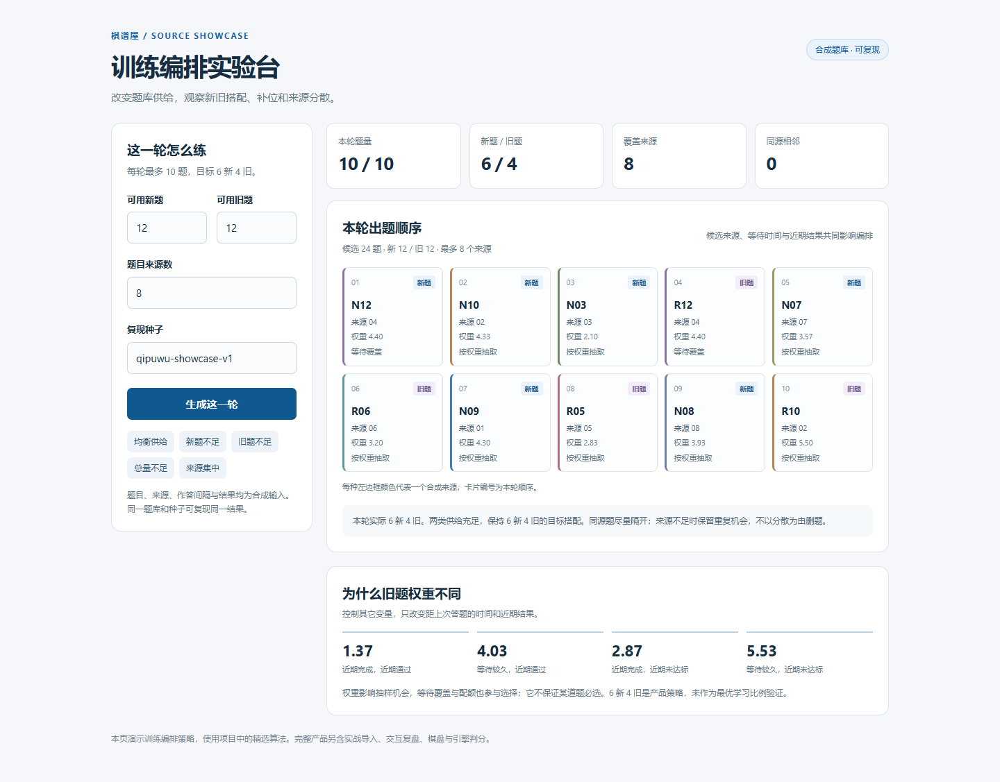
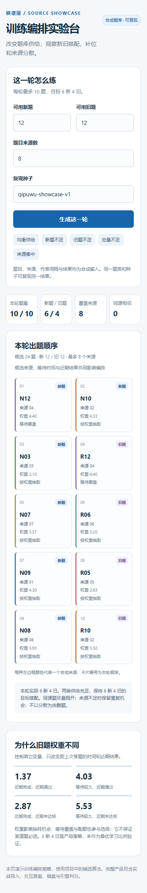

# 棋谱屋 · QipuWu

**象棋复盘与训练系统 · Xiangqi Review & Practice**

把实战棋局、引擎分析与针对性练习连接起来，让一次复盘能够进入后续学习。

这里整理了棋谱屋的训练编排模块，以及一份使用合成题目的交互实验台。

[English](README.en.md) · [产品设计](docs/product-design.md) · [代码来源](docs/source-provenance.md)



## 从实战到练习

实战棋局 → 引擎测量 → 复盘与自由试走 → 自主选择收录 → 分主题练习 → 回看原局。

回看原局后可继续复盘与自由试走，形成复盘与练习的循环。

完整产品围绕日常使用持续迭代，主要包括：

- **复盘报告**：查看逐着评价，定位值得研究的决策，并回到棋盘自由试走。
- **个人训练材料**：使用者自主决定收录，连接原始棋局与后续练习。
- **复习编排**：结合新旧题、作答间隔、近期表现与题目来源组织练习。
- **开局学习**：发现跨盘重复局面，围绕个人选择的方向继续研究与训练。

## 训练编排

代码取自棋谱屋当前使用的训练调度模块，规则如下：

| 设计 | 对使用体验的意义 |
| --- | --- |
| 每轮以 6 道新题、4 道复习题为目标 | 在接触新内容与保持旧内容之间安排节奏 |
| 新旧题可相互补位 | 某类题目不足时，仍能利用已有可靠材料 |
| 实际间隔与近期结果影响优先级 | 让复习顺序响应练习历史 |
| 来源分散是软偏好 | 尽量避免连续集中于同一盘，同时保留材料可用性 |
| 固定种子生成确定结果 | 让编排过程能够重现、检查与比较 |

这些参数描述产品当前的安排规则，不代表经过验证的最优学习间隔。

### 运行演示

环境：**Python 3.10+**，仅使用标准库。

在仓库根目录运行：

```bash
python examples/schedule_demo.py
```

打开交互实验台：

```bash
python examples/serve_schedule_lab.py
```

终端会打印本机地址，在浏览器打开即可。可以切换五种题目供给场景，观察新旧题补位、来源分散和优先级变化。

运行检查：

```bash
python -m unittest discover -s tests -v
```

18 项模块与 HTTP 检查、桌面和手机的浏览器验收记录见[验证说明](docs/verification.md)。演示使用合成题目，展示训练编排这一独立模块；完整产品的棋盘、采集、引擎和个人记录不属于该演示的运行范围。

<details>
<summary>查看移动端演示</summary>



</details>

## 产品设计重点

**评价与学习状态分开。** 引擎负责棋盘评价，使用者决定哪些内容值得练习；收录表示学习意愿，原题答对也不直接等于已掌握。

**先让反馈可信，再组织训练。** 评分视角、普通分值与杀棋结果、参考来源需要有明确口径；前台使用与后台计算也需要协调，保留结果来源与版本。

**围绕真实使用迭代。** 产品的重点是让使用者更容易研究局面、形成候选着并回到练习，而不是增加统计和标签的数量。跨局面迁移与长期学习效果仍需独立验证。

## 仓库范围

此仓库包括训练编排代码、独立演示、检查和产品设计记录。代码的原始相对位置、提取方式与校验信息见[来源说明](docs/source-provenance.md)。

完整产品使用的第三方棋盘、引擎、权重与其他资料有各自的来源及许可；本仓库的精选模块不打包这些组件。
